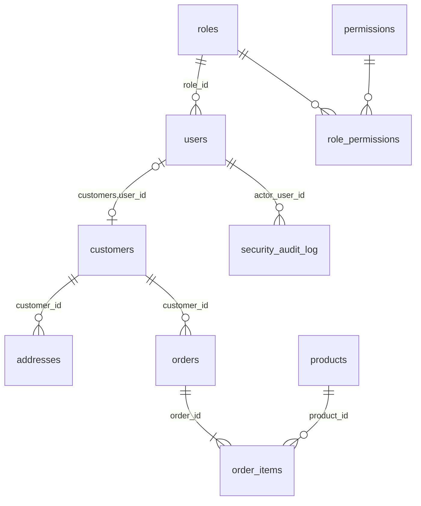

# DATABASE_UPGRADE_AND_SEED.md

**Dự án:** `php_admin_product_manager` (repo `LeGiaLam-gif/CEHv13-Module14-HackingWebApplications-Lab-`, commit gốc `f9effb8`)
**Mục đích:** Mô tả chi tiết nâng cấp cơ sở dữ liệu và dữ liệu seed để hỗ trợ lab **Broken Access Control** (vertical/horizontal, BOLA/IDOR, BFLA) và **Mass Assignment / BOPLA** (OWASP API3:2023).
**Trạng thái:** Tài liệu thiết kế. Chưa chạy migration, chưa sửa mã nguồn.
**Tài liệu liên quan:** `FEATURE_UPGRADE_REQUIREMENTS.md` (yêu cầu tính năng), các tài liệu trong blueprint đã duyệt.

---

## 1. Nguyên tắc thiết kế

1. **Giữ nguyên baseline:** không xóa, không đổi tên, không sửa kiểu dữ liệu của bảng hiện có. Panel admin cũ và `/api/*` cũ phải chạy y như trước.
2. **Thay đổi nhỏ nhất:** chỉ thêm những gì kịch bản bảo mật cần (mỗi bảng/cột đều có lý do ở mục 4).
3. **Tái sử dụng chuỗi sở hữu có sẵn:** `orders.customer_id → customers`; chỉ thêm `customers.user_id → users`. Chủ sở hữu đơn hàng = `customers.user_id`.
4. **Migration additive và có rollback.** Seed chạy bằng script PHP (băm mật khẩu lúc chạy), không để hash/mật khẩu trong SQL.
5. **Dữ liệu giả hoàn toàn:** email `@lab.test`, số điện thoại giả, mật khẩu chỉ dùng cho lab local.

---

## 2. Hiện trạng cơ sở dữ liệu (đã kiểm chứng từ `database/init.sql` và `migrations/001–005`)

| Bảng | PK | FK | Ghi chú liên quan đến bảo mật |
|---|---|---|---|
| `admins` | `id` | none | Danh tính duy nhất; không có cột role. `username`, `email` UNIQUE. |
| `admin_password_resets` | `id` | `admin_id → admins` (CASCADE) | `token_hash` UNIQUE; hết hạn bằng `expires_at`. |
| `categories` | `id` | none | `name` UNIQUE, `status`. |
| `brands` | `id` | none | `name` UNIQUE, `status`. |
| `products` | `id` | `category_id → categories` (RESTRICT), `brand_id → brands` (RESTRICT) | `sku` UNIQUE, `quantity`, `unit_price DECIMAL(15,2)`, `status`. |
| `product_images` | `id` | `product_id → products` (CASCADE) | UNIQUE `(product_id, image_path)`. |
| `customers` | `id` | none | Hồ sơ khách (CRM), **không có tài khoản đăng nhập**; `address` là một chuỗi NOT NULL. |
| `orders` | `id` | `customer_id → customers` (SET NULL) | `status VARCHAR(30)` (không có CHECK/ENUM), snapshot `customer_name/phone/shipping_address`, `total_amount`. |
| `order_items` | `id` | `order_id → orders` (CASCADE), `product_id → products` (SET NULL) | Lưu snapshot tên/SKU/giá, `line_total`. |
| `inventory_movements` | `id` | `product_id → products` (SET NULL), `admin_id → admins` (SET NULL) | `admin_id` cho phép NULL. |
| `admin_activity_logs` | `id` | `admin_id → admins` (SET NULL) | Chỉ ghi hành động admin thành công. |

**Giá trị `orders.status` hợp lệ (từ `order_status_labels()`):** `new`, `confirmed`, `processing`, `shipping`, `completed`, `cancelled`. Luồng chuyển: `new → confirmed → processing → shipping → completed`; được hủy khi ở `new/confirmed/processing` (`order_can_cancel()`).

**Điểm yếu thiết kế (đối với mục tiêu lab):**
- Không có khái niệm user/role/permission → không thể có BAC.
- Không có quan hệ "ai sở hữu đơn hàng/địa chỉ" ngoài `customers`, mà `customers` không gắn với tài khoản.
- Địa chỉ chỉ là một chuỗi trong `customers.address`, không có đối tượng địa chỉ riêng.
- Không có thuộc tính nhạy cảm cấp đơn hàng như `payment_status`.
- Không có nơi ghi nhận các yêu cầu bị từ chối.
- `init.sql` chỉ chạy ở lần khởi tạo volume đầu tiên; migrations chạy tay, không có runner. `init.sql` và `001–004` cùng hard-code `admin_product_db`.

---

## 3. Tổng quan thay đổi

| # | Thay đổi | Loại | Bắt buộc? | Kịch bản |
|---|---|---|---|---|
| 1 | `roles` | Bảng mới | Có | A1, A4 |
| 2 | `permissions` | Bảng mới | Có | A1, A4 |
| 3 | `role_permissions` | Bảng mới | Có | A1, A4 |
| 4 | `users` | Bảng mới | Có | A1–A4, B1, B2 |
| 5 | `customers.user_id` | Thêm cột + FK + UNIQUE | Có | A2, A3 |
| 6 | `addresses` | Bảng mới | Có | A2, A3 |
| 7 | `orders.payment_status` | Thêm cột | Có | B3 |
| 8 | `security_audit_log` | Bảng mới | Khuyến nghị | Bằng chứng mọi test |
| — | `user_profiles`, `payments`, sở hữu sản phẩm | **Không tạo** | — | Thừa so với yêu cầu |

Thêm cột `users.store_credit` là **tùy chọn** (thuộc tính tài chính nhạy cảm để minh họa BOPLA); mặc định đưa vào vì chi phí thấp.

### Ý nghĩa quan hệ đối với kiểm thử



- `roles → permissions` trả lời câu hỏi **function-level**: vai trò này có được gọi hàm này không (A1, A4).
- `users → customers → orders/addresses` trả lời câu hỏi **object-level**: bản ghi này có thuộc về người gọi không (A2, A3).
- `users.role_id`, `users.account_status`, `users.store_credit`, `orders.payment_status`, `orders.total_amount` là các **thuộc tính nhạy cảm** cho Mass Assignment/BOPLA (B1–B5).

---

## 4. Đặc tả chi tiết từng bảng

### 4.1. `roles`
- **Mục đích:** danh mục vai trò: `admin`, `staff_catalog`, `staff_orders`, `customer`.
- **Cột:** `id INT AUTO_INCREMENT` (PK), `name VARCHAR(50) NOT NULL` (UNIQUE).
- **Quan hệ:** 1–N với `users`, N–N với `permissions` qua `role_permissions`.
- **Lý do:** cho phép đổi quyền bằng dữ liệu thay vì sửa code; làm rõ sự khác nhau giữa 2 nhân viên (staff).

### 4.2. `permissions`
- **Mục đích:** mã quyền theo hành động (function-level).
- **Cột:** `id INT AUTO_INCREMENT` (PK), `code VARCHAR(80) NOT NULL` (UNIQUE), `description VARCHAR(255) NULL`.
- **Danh sách:** `products.update`, `products.set_price`, `products.delete`, `orders.read_all`, `orders.update_status`, `orders.set_payment`, `users.read_all`, `users.manage`, `users.delete`, `audit.read`.
- **Lý do:** tách `products.update` khỏi `products.set_price` để minh họa phân quyền theo **thuộc tính** (B4). Quyền của `customer` không nằm trong bảng này vì dựa trên **sở hữu** (ownership), không phải quyền chức năng.

### 4.3. `role_permissions`
- **Cột:** `role_id INT NOT NULL`, `permission_id INT NOT NULL`; PK ghép `(role_id, permission_id)`.
- **FK:** `role_id → roles(id)` ON DELETE CASCADE; `permission_id → permissions(id)` ON DELETE CASCADE.

### 4.4. `users`
- **Mục đích:** danh tính thống nhất cho admin lab, staff và customer; mang các thuộc tính nhạy cảm.

| Cột | Kiểu | Ràng buộc / mặc định | Ghi chú |
|---|---|---|---|
| `id` | INT AUTO_INCREMENT | PK | ID tuần tự → dễ liệt kê (phục vụ IDOR) |
| `username` | VARCHAR(100) | NOT NULL, UNIQUE | |
| `email` | VARCHAR(150) | NOT NULL, UNIQUE | |
| `password_hash` | VARCHAR(255) | NOT NULL | Chỉ `password_hash()`; không bao giờ trả ra response ở secure mode |
| `full_name` | VARCHAR(150) | NULL | Người dùng được sửa |
| `phone` | VARCHAR(30) | NULL | Người dùng được sửa |
| `role_id` | INT | NOT NULL, FK `roles(id)` | **Thuộc tính nhạy cảm**: chỉ admin đổi qua endpoint riêng |
| `account_status` | ENUM('pending','active','suspended') | NOT NULL DEFAULT 'active' | **Nhạy cảm**: chỉ admin/hệ thống |
| `store_credit` | DECIMAL(15,2) | NOT NULL DEFAULT 0 | **Nhạy cảm (tùy chọn)**; đơn vị VND như `products.unit_price` |
| `created_at` / `updated_at` | TIMESTAMP | DEFAULT CURRENT_TIMESTAMP (/ ON UPDATE) | Read-only |

- **Index:** `idx_users_role (role_id)`; UNIQUE `username`, `email` có sẵn index.
- **Lý do không tái dùng `admins`:** giữ baseline nguyên vẹn (FK từ `admin_password_resets`, `inventory_movements`, `admin_activity_logs`). Hệ quả: hai bảng danh tính song song (xem mục 9).

### 4.5. `customers` (thêm cột)
- **Thêm:** `user_id INT NULL`, UNIQUE, FK `users(id)` ON DELETE SET NULL.
- **Lý do:** tạo chuỗi sở hữu `users → customers → orders/addresses` mà không đụng đến `orders`. Khách cũ do admin tạo (không có tài khoản) vẫn hợp lệ vì `user_id` NULL.
- **Ràng buộc nghiệp vụ:** 1 user customer ↔ tối đa 1 hồ sơ customer.

### 4.6. `addresses`

| Cột | Kiểu | Ràng buộc / mặc định |
|---|---|---|
| `id` | INT AUTO_INCREMENT | PK |
| `customer_id` | INT | NOT NULL, FK `customers(id)` ON DELETE CASCADE |
| `label` | VARCHAR(50) | NOT NULL DEFAULT 'home' |
| `line1` | VARCHAR(255) | NOT NULL |
| `city` | VARCHAR(100) | NOT NULL |
| `phone` | VARCHAR(30) | NULL |
| `is_default` | TINYINT(1) | NOT NULL DEFAULT 0 |
| `created_at` | TIMESTAMP | DEFAULT CURRENT_TIMESTAMP |

- **Index:** `idx_addresses_customer (customer_id)`.
- **Lý do:** cần một đối tượng có ID riêng, thuộc về một chủ sở hữu, để thể hiện "Customer A xóa địa chỉ của Customer B" (A2) và IDOR trên `/addresses/{id}` (A3).

### 4.7. `orders` (thêm cột)
- **Thêm:** `payment_status ENUM('unpaid','paid','refunded') NOT NULL DEFAULT 'unpaid'` đặt sau `status`.
- **Lý do:** thuộc tính do **hệ thống/admin** kiểm soát; khách không được tự đặt `paid` (B3). `status`, `total_amount`, `customer_id` và đơn giá từng dòng đã là thuộc tính của hệ thống (server tính trong `order_create()`).

### 4.8. `security_audit_log` (khuyến nghị)

| Cột | Kiểu | Ghi chú |
|---|---|---|
| `id` | BIGINT AUTO_INCREMENT PK | |
| `actor_user_id` | INT NULL | Không đặt FK cứng để log vẫn còn khi user bị xóa (xem DDL) |
| `method` | VARCHAR(10) NOT NULL | |
| `route` | VARCHAR(255) NOT NULL | |
| `target_type` / `target_id` | VARCHAR(40) / INT NULL | |
| `decision` | ENUM('allow','deny') NOT NULL | |
| `reason` | VARCHAR(255) NULL | Ví dụ `missing_permission:products.delete`, `not_owner`, `restricted_field:role_id` |
| `lab_mode` | VARCHAR(20) NOT NULL | `secure` / `vulnerable` / `custom` |
| `ip_address` | VARCHAR(45) NULL | |
| `created_at` | TIMESTAMP DEFAULT CURRENT_TIMESTAMP | |

- **Index:** `idx_audit_actor (actor_user_id)`, `idx_audit_target (target_type, target_id)`, `idx_audit_created (created_at)`.
- **Lý do:** `admin_activity_logs` chỉ ghi hành động thành công của admin và gắn với `admins`. Lab cần chứng cứ cho cả yêu cầu bị từ chối (secure) và yêu cầu vượt quyền thành công (vulnerable).

---

## 5. Migration SQL

Quy ước: các file lab **không** có dòng `USE ...` (khác `001–004`); chọn DB khi chạy lệnh `mysql`. MySQL 8.0 không hỗ trợ `ADD COLUMN IF NOT EXISTS`, vì vậy mỗi migration chỉ chạy **một lần**; kiểm tra trước bằng `information_schema` (mục 5.4).

### 5.1. `database/migrations/006_lab_identity_rbac.sql`

```sql
CREATE TABLE roles (
    id INT AUTO_INCREMENT PRIMARY KEY,
    name VARCHAR(50) NOT NULL UNIQUE
) ENGINE=InnoDB;

CREATE TABLE permissions (
    id INT AUTO_INCREMENT PRIMARY KEY,
    code VARCHAR(80) NOT NULL UNIQUE,
    description VARCHAR(255) NULL
) ENGINE=InnoDB;

CREATE TABLE role_permissions (
    role_id INT NOT NULL,
    permission_id INT NOT NULL,
    PRIMARY KEY (role_id, permission_id),
    CONSTRAINT fk_rp_role FOREIGN KEY (role_id) REFERENCES roles(id) ON DELETE CASCADE,
    CONSTRAINT fk_rp_permission FOREIGN KEY (permission_id) REFERENCES permissions(id) ON DELETE CASCADE
) ENGINE=InnoDB;

CREATE TABLE users (
    id INT AUTO_INCREMENT PRIMARY KEY,
    username VARCHAR(100) NOT NULL UNIQUE,
    email VARCHAR(150) NOT NULL UNIQUE,
    password_hash VARCHAR(255) NOT NULL,
    full_name VARCHAR(150) NULL,
    phone VARCHAR(30) NULL,
    role_id INT NOT NULL,
    account_status ENUM('pending','active','suspended') NOT NULL DEFAULT 'active',
    store_credit DECIMAL(15,2) NOT NULL DEFAULT 0,
    created_at TIMESTAMP DEFAULT CURRENT_TIMESTAMP,
    updated_at TIMESTAMP DEFAULT CURRENT_TIMESTAMP ON UPDATE CURRENT_TIMESTAMP,
    CONSTRAINT fk_users_role FOREIGN KEY (role_id) REFERENCES roles(id),
    INDEX idx_users_role (role_id),
    CONSTRAINT chk_users_store_credit CHECK (store_credit >= 0)
) ENGINE=InnoDB;

ALTER TABLE customers
    ADD COLUMN user_id INT NULL AFTER id,
    ADD UNIQUE KEY uq_customers_user (user_id),
    ADD CONSTRAINT fk_customers_user FOREIGN KEY (user_id) REFERENCES users(id) ON DELETE SET NULL;
```

### 5.2. `database/migrations/007_lab_addresses_order_payment.sql`

```sql
CREATE TABLE addresses (
    id INT AUTO_INCREMENT PRIMARY KEY,
    customer_id INT NOT NULL,
    label VARCHAR(50) NOT NULL DEFAULT 'home',
    line1 VARCHAR(255) NOT NULL,
    city VARCHAR(100) NOT NULL,
    phone VARCHAR(30) NULL,
    is_default TINYINT(1) NOT NULL DEFAULT 0,
    created_at TIMESTAMP DEFAULT CURRENT_TIMESTAMP,
    CONSTRAINT fk_addresses_customer FOREIGN KEY (customer_id) REFERENCES customers(id) ON DELETE CASCADE,
    INDEX idx_addresses_customer (customer_id)
) ENGINE=InnoDB;

ALTER TABLE orders
    ADD COLUMN payment_status ENUM('unpaid','paid','refunded') NOT NULL DEFAULT 'unpaid' AFTER status;
```

### 5.3. `database/migrations/008_lab_security_audit.sql`

```sql
CREATE TABLE security_audit_log (
    id BIGINT AUTO_INCREMENT PRIMARY KEY,
    actor_user_id INT NULL,
    method VARCHAR(10) NOT NULL,
    route VARCHAR(255) NOT NULL,
    target_type VARCHAR(40) NULL,
    target_id INT NULL,
    decision ENUM('allow','deny') NOT NULL,
    reason VARCHAR(255) NULL,
    lab_mode VARCHAR(20) NOT NULL,
    ip_address VARCHAR(45) NULL,
    created_at TIMESTAMP DEFAULT CURRENT_TIMESTAMP,
    INDEX idx_audit_actor (actor_user_id),
    INDEX idx_audit_target (target_type, target_id),
    INDEX idx_audit_created (created_at)
) ENGINE=InnoDB;
```

### 5.4. Cách chạy và kiểm tra (đề xuất, chưa thực thi)

```bash
# Chạy từng file (tên container theo docker-compose.yml hiện tại)
docker exec -i php_admin_product_mysql \
  mysql -uroot -p"$DB_ROOT_PASSWORD" admin_product_db < database/migrations/006_lab_identity_rbac.sql
```

```sql
-- Kiểm tra migration đã áp dụng chưa trước khi chạy lại
SELECT COUNT(*) FROM information_schema.tables
 WHERE table_schema = DATABASE() AND table_name = 'users';
SELECT COUNT(*) FROM information_schema.columns
 WHERE table_schema = DATABASE() AND table_name = 'customers' AND column_name = 'user_id';
SELECT COUNT(*) FROM information_schema.columns
 WHERE table_schema = DATABASE() AND table_name = 'orders' AND column_name = 'payment_status';
```

### 5.5. Rollback (chỉ dùng trên DB lab)

```sql
-- 008 down
DROP TABLE IF EXISTS security_audit_log;
-- 007 down
ALTER TABLE orders DROP COLUMN payment_status;
DROP TABLE IF EXISTS addresses;
-- 006 down (thứ tự quan trọng vì FK)
ALTER TABLE customers DROP FOREIGN KEY fk_customers_user, DROP INDEX uq_customers_user, DROP COLUMN user_id;
DROP TABLE IF EXISTS users;
DROP TABLE IF EXISTS role_permissions;
DROP TABLE IF EXISTS permissions;
DROP TABLE IF EXISTS roles;
```

### 5.6. Cách tách DB lab khỏi DB gốc

`init.sql` và migrations cũ hard-code `admin_product_db`, nên đổi tên DB sẽ phá khởi tạo. Cách thực hiện: **giữ tên DB**, nhưng chạy lab bằng một Docker Compose project riêng (`docker compose -p phplab -f docker-compose.yml -f docker-compose.lab.yml ...`) với **volume riêng** (`mysql_lab_data`) và tên container riêng. Nhờ vậy DB lab không chung dữ liệu với môi trường gốc. (Đây là điều chỉnh nhỏ so với bản blueprint, nơi tôi nêu "tên DB riêng".)

---

## 6. Dữ liệu seed

### 6.1. Dữ liệu hiện có trong `init.sql` (giữ nguyên)

| Bảng | Dữ liệu |
|---|---|
| `admins` | 1 dòng: `admin` / `admin@example.com` (admin gốc, **không** dùng cho lab v2) |
| `categories` | 1 Laptop, 2 Điện thoại, 3 Phụ kiện |
| `products` | 1 Laptop Dell Inspiron 15 (qty 10, 15.500.000), 2 iPhone Demo 128GB (qty 5, 21.900.000), 3 Chuột không dây Logitech (qty 30, 350.000) |

### 6.2. Seed lab (script `database/lab/seed_lab.php`)

#### Vai trò và quyền

| role_id | name |
|---|---|
| 1 | admin |
| 2 | staff_catalog |
| 3 | staff_orders |
| 4 | customer |

| permission_id | code |
|---|---|
| 1 | products.update |
| 2 | products.set_price |
| 3 | products.delete |
| 4 | orders.read_all |
| 5 | orders.update_status |
| 6 | orders.set_payment |
| 7 | users.read_all |
| 8 | users.manage |
| 9 | users.delete |
| 10 | audit.read |

| Vai trò | permission_id |
|---|---|
| admin | 1–10 (tất cả) |
| staff_catalog | 1 |
| staff_orders | 4, 5 |
| customer | không có (dựa trên sở hữu) |

```sql
INSERT INTO roles (id, name) VALUES (1,'admin'),(2,'staff_catalog'),(3,'staff_orders'),(4,'customer');

INSERT INTO permissions (id, code, description) VALUES
 (1,'products.update','Sửa thông tin sản phẩm (không gồm giá)'),
 (2,'products.set_price','Đổi đơn giá sản phẩm'),
 (3,'products.delete','Xóa sản phẩm'),
 (4,'orders.read_all','Xem mọi đơn hàng'),
 (5,'orders.update_status','Cập nhật trạng thái đơn'),
 (6,'orders.set_payment','Đặt payment_status'),
 (7,'users.read_all','Xem mọi người dùng'),
 (8,'users.manage','Đổi role/account_status'),
 (9,'users.delete','Xóa người dùng'),
 (10,'audit.read','Xem security_audit_log');

INSERT INTO role_permissions (role_id, permission_id) VALUES
 (1,1),(1,2),(1,3),(1,4),(1,5),(1,6),(1,7),(1,8),(1,9),(1,10),
 (2,1),
 (3,4),(3,5);
```

#### Tài khoản kiểm thử (chỉ dùng cho lab local)

| user_id | username | Vai trò | Email | Mật khẩu lab | store_credit |
|---|---|---|---|---|---|
| 1 | `lab_admin` | admin | lab_admin@lab.test | `Admin@Lab2026` | 0 |
| 2 | `lab_staff_cat` | staff_catalog | lab_staff_cat@lab.test | `StaffCat@Lab2026` | 0 |
| 3 | `lab_staff_ord` | staff_orders | lab_staff_ord@lab.test | `StaffOrd@Lab2026` | 0 |
| 4 | `alice` | customer | alice@lab.test | `Alice@Lab2026` | 0 |
| 5 | `bob` | customer | bob@lab.test | `Bob@Lab2026` | 500000.00 |
| 6 | `carol` | customer | carol@lab.test | `Carol@Lab2026` | 0 |

Mật khẩu **không** nằm trong SQL. Seeder băm bằng `password_hash($pw, PASSWORD_DEFAULT)` rồi chèn:

```sql
INSERT INTO users (id, username, email, password_hash, full_name, phone, role_id, account_status, store_credit) VALUES
 (1,'lab_admin','lab_admin@lab.test',:h1,'Lab Admin','0900000001',1,'active',0),
 (2,'lab_staff_cat','lab_staff_cat@lab.test',:h2,'Staff Catalog','0900000002',2,'active',0),
 (3,'lab_staff_ord','lab_staff_ord@lab.test',:h3,'Staff Orders','0900000003',3,'active',0),
 (4,'alice','alice@lab.test',:h4,'Alice Nguyen','0900000004',4,'active',0),
 (5,'bob','bob@lab.test',:h5,'Bob Tran','0900000005',4,'active',500000.00),
 (6,'carol','carol@lab.test',:h6,'Carol Le','0900000006',4,'active',0);
```

#### Sản phẩm bổ sung (3 sản phẩm mới, ID 4–6)

```sql
INSERT INTO products (id, category_id, name, sku, description, quantity, unit_price, status) VALUES
 (4,1,'Laptop Asus Vivobook 14','LAP-ASUS-001','Laptop mỏng nhẹ cho sinh viên',8,12900000,1),
 (5,2,'Samsung Galaxy A55 128GB','PHONE-SS-001','Sản phẩm demo',12,9800000,1),
 (6,3,'Tai nghe Sony WH-CH520','ACC-HEAD-001','Tai nghe không dây',25,1150000,1);
```

#### Hồ sơ khách hàng (liên kết user ↔ customers)

```sql
INSERT INTO customers (id, user_id, name, phone, email, address, notes) VALUES
 (1,4,'Alice Nguyen','0900000004','alice@lab.test','12 Nguyễn Huệ, Quận 1, TP.HCM','Lab customer A'),
 (2,5,'Bob Tran','0900000005','bob@lab.test','88 Trần Phú, Hải Châu, Đà Nẵng','Lab customer B'),
 (3,6,'Carol Le','0900000006','carol@lab.test','15 Hoàng Diệu, Ba Đình, Hà Nội','Lab customer C');
```

#### Địa chỉ (5 dòng, mỗi chủ sở hữu nhiều hơn 1 để so sánh ID)

```sql
INSERT INTO addresses (id, customer_id, label, line1, city, phone, is_default) VALUES
 (1,1,'home','12 Nguyễn Huệ, Quận 1','TP.HCM','0900000004',1),
 (2,1,'office','45 Lê Lợi, Quận 1','TP.HCM','0900000004',0),
 (3,2,'home','88 Trần Phú, Hải Châu','Đà Nẵng','0900000005',1),
 (4,2,'office','20 Bạch Đằng, Hải Châu','Đà Nẵng','0900000005',0),
 (5,3,'home','15 Hoàng Diệu, Ba Đình','Hà Nội','0900000006',1);
```

#### Đơn hàng (5 đơn, nhiều trạng thái khác nhau)

| order_id | Chủ sở hữu | status | payment_status | Dòng hàng | total_amount |
|---|---|---|---|---|---|
| 1 | Alice (customer 1) | `completed` | `paid` | SP1 ×1, SP3 ×1 | 15.850.000 |
| 2 | Alice | `new` | `unpaid` | SP6 ×2 | 2.300.000 |
| 3 | Bob (customer 2) | `processing` | `paid` | SP2 ×1, SP3 ×2 | 22.600.000 |
| 4 | Bob | `new` | `unpaid` | SP5 ×1, SP6 ×1 | 10.950.000 |
| 5 | Carol (customer 3) | `confirmed` | `unpaid` | SP4 ×1, SP3 ×1, SP6 ×1 | 14.400.000 |

```sql
INSERT INTO orders (id, customer_id, customer_name, customer_phone, shipping_address, status, payment_status, total_amount) VALUES
 (1,1,'Alice Nguyen','0900000004','12 Nguyễn Huệ, Quận 1, TP.HCM','completed','paid',15850000),
 (2,1,'Alice Nguyen','0900000004','45 Lê Lợi, Quận 1, TP.HCM','new','unpaid',2300000),
 (3,2,'Bob Tran','0900000005','88 Trần Phú, Hải Châu, Đà Nẵng','processing','paid',22600000),
 (4,2,'Bob Tran','0900000005','20 Bạch Đằng, Hải Châu, Đà Nẵng','new','unpaid',10950000),
 (5,3,'Carol Le','0900000006','15 Hoàng Diệu, Ba Đình, Hà Nội','confirmed','unpaid',14400000);

INSERT INTO order_items (order_id, product_id, product_name, product_sku, quantity, unit_price, line_total) VALUES
 (1,1,'Laptop Dell Inspiron 15','LAP-DELL-001',1,15500000,15500000),
 (1,3,'Chuột không dây Logitech','ACC-MOUSE-001',1,350000,350000),
 (2,6,'Tai nghe Sony WH-CH520','ACC-HEAD-001',2,1150000,2300000),
 (3,2,'iPhone Demo 128GB','PHONE-IP-001',1,21900000,21900000),
 (3,3,'Chuột không dây Logitech','ACC-MOUSE-001',2,350000,700000),
 (4,5,'Samsung Galaxy A55 128GB','PHONE-SS-001',1,9800000,9800000),
 (4,6,'Tai nghe Sony WH-CH520','ACC-HEAD-001',1,1150000,1150000),
 (5,4,'Laptop Asus Vivobook 14','LAP-ASUS-001',1,12900000,12900000),
 (5,3,'Chuột không dây Logitech','ACC-MOUSE-001',1,350000,350000),
 (5,6,'Tai nghe Sony WH-CH520','ACC-HEAD-001',1,1150000,1150000);
```

**Lưu ý về kho:** seed chèn trực tiếp nên **không** trừ `products.quantity` và **không** sinh `inventory_movements`. Các test cần kiểm tra tồn kho (checkout, hủy đơn hoàn kho) phải dùng giá trị chênh lệch (trước/sau) chứ không so với một con số tuyệt đối, hoặc tạo đơn mới qua API.

### 6.3. Ma trận sở hữu và cặp dữ liệu dùng cho test

| Mục đích | Tác nhân | Đối tượng | ID |
|---|---|---|---|
| Horizontal / BOLA đơn hàng | alice | đơn của Bob | `orders/3`, `orders/4` |
| Horizontal / BOLA địa chỉ | alice | địa chỉ của Bob | `addresses/3`, `addresses/4` |
| IDOR user | alice | hồ sơ Bob | `users/5` |
| Truy cập hợp lệ (đối chứng) | alice | đơn/địa chỉ của chính mình | `orders/1,2`, `addresses/1,2` |
| Hủy đơn hợp lệ | alice / bob | đơn còn hủy được | `orders/2` (new), `orders/4` (new) |
| Không được hủy | alice | đơn đã hoàn thành | `orders/1` (completed) |
| Vertical | alice | xóa sản phẩm | `products/3` |
| BFLA | lab_staff_ord | đổi role user | `users/4/role` |
| BFLA | lab_staff_cat | xóa sản phẩm | `products/1` |
| Mass Assignment (BOPLA) | bob | thuộc tính nhạy cảm | `users/5`: `role_id`, `store_credit`; `orders/4`: `payment_status` |

### 6.4. Seeder `database/lab/seed_lab.php` (đặc tả)

- **Chạy bằng CLI:** `php database/lab/seed_lab.php [--reset]`, từ chối chạy nếu `APP_ENV != local`.
- **Idempotent:** dùng ID cố định ở trên và `INSERT ... ON DUPLICATE KEY UPDATE` (`roles/permissions/role_permissions`) hoặc `INSERT IGNORE` khi hợp lý; chạy lại nhiều lần không sinh dòng trùng.
- **`--reset`:** trong một transaction, xóa theo thứ tự FK các dòng lab (`order_items` → `orders` → `addresses` → `customers` với `user_id IS NOT NULL` → `users` có email `@lab.test`), rồi seed lại. Không xóa `admins`, `categories`, sản phẩm 1–3 gốc. Sau reset, đặt lại `products.quantity` của SP1–6 về giá trị mục 6.1/6.2.
- **Băm mật khẩu** bằng `password_hash()` lúc chạy; bảng mật khẩu lab ở mục 6.2 chỉ nằm trong tài liệu này và `TEST_PLAN.md`.
- **In ra:** tóm tắt số dòng đã chèn/cập nhật cho từng bảng.

Khung code tham khảo:

```php
<?php
require_once __DIR__ . '/../../app/src/db.php';
if (getenv('APP_ENV') !== 'local') { fwrite(STDERR, "Refusing: APP_ENV must be local\n"); exit(1); }

$users = [
  [1,'lab_admin','lab_admin@lab.test','Admin@Lab2026','Lab Admin','0900000001',1,0],
  // ... các tài khoản còn lại theo bảng ở mục 6.2
];
$pdo = db();
$pdo->beginTransaction();
$stmt = $pdo->prepare(
  "INSERT INTO users (id,username,email,password_hash,full_name,phone,role_id,account_status,store_credit)
   VALUES (:id,:u,:e,:h,:n,:p,:r,'active',:c)
   ON DUPLICATE KEY UPDATE email=VALUES(email), full_name=VALUES(full_name), role_id=VALUES(role_id)"
);
foreach ($users as [$id,$u,$e,$pw,$n,$p,$r,$c]) {
  $stmt->execute(['id'=>$id,'u'=>$u,'e'=>$e,'h'=>password_hash($pw, PASSWORD_DEFAULT),'n'=>$n,'p'=>$p,'r'=>$r,'c'=>$c]);
}
$pdo->commit();
```

---

## 7. Truy vấn kiểm chứng (dùng làm bằng chứng trong Burp test)

```sql
-- B1: đăng ký có bị gán quyền không?
SELECT id, username, role_id, account_status FROM users WHERE username = 'eve';

-- B2: profile của Bob có bị đổi trường nhạy cảm không?
SELECT id, full_name, phone, role_id, account_status, store_credit FROM users WHERE id = 5;

-- B3: đơn hàng có bị đặt trường do server quản lý không?
SELECT id, customer_id, status, payment_status, total_amount FROM orders WHERE id = 4;
SELECT product_id, unit_price, line_total FROM order_items WHERE order_id = 4;

-- B4: giá sản phẩm có bị staff_catalog đổi không?
SELECT id, name, unit_price, quantity, status FROM products WHERE id = 1;

-- A1/A4: sản phẩm có bị xóa không?
SELECT COUNT(*) FROM products WHERE id = 3;

-- A2: địa chỉ của Bob còn tồn tại không?
SELECT id, customer_id FROM addresses WHERE id IN (3,4);

-- Quyền hiệu lực của một user
SELECT p.code FROM users u
JOIN role_permissions rp ON rp.role_id = u.role_id
JOIN permissions p ON p.id = rp.permission_id
WHERE u.username = 'lab_staff_cat';

-- Kiểm tra sở hữu (logic mà ownership policy phải bám theo)
SELECT o.id FROM orders o
JOIN customers c ON c.id = o.customer_id
WHERE o.id = 3 AND c.user_id = 4;     -- alice (user 4) với đơn của Bob → 0 dòng

-- Audit
SELECT id, actor_user_id, method, route, target_type, target_id, decision, reason, lab_mode
FROM security_audit_log ORDER BY id DESC LIMIT 20;
```

---

## 8. Tiêu chí chấp nhận (cho giai đoạn DB)

1. Sau 006–008, các bảng/cột ở mục 3 tồn tại; không bảng hiện có nào bị xóa hoặc đổi kiểu.
2. Panel admin và `/api/*` cũ vẫn hoạt động; thao tác tạo đơn từ panel vẫn thành công (cột `payment_status` có mặc định).
3. Seeder chạy hai lần liên tiếp cho kết quả giống nhau (số dòng không đổi).
4. `--reset` đưa dữ liệu lab về đúng trạng thái mục 6.
5. Truy vấn ownership ở mục 7 trả đúng: Alice sở hữu đơn 1–2, Bob 3–4, Carol 5.
6. `grep` không tìm thấy hash hay mật khẩu lab trong file `.sql`.
7. Rollback ở mục 5.5 đưa schema về trạng thái trước 006.

---

## 9. Rủi ro và điểm cần lưu ý

- **Hai bảng danh tính** (`admins` cho panel cũ, `users` cho lab v2) là lựa chọn có chủ đích để giữ baseline; hợp nhất sau này đòi hỏi di chuyển FK của `admin_password_resets`, `inventory_movements`, `admin_activity_logs`.
- **`order_create()` hiện yêu cầu `adminId` dương** và ghi vào `inventory_movements.admin_id`; cột này cho phép NULL nên chỉ cần đổi tham số thành `?int` trong mã (thuộc tài liệu tính năng, phải có test hồi quy).
- **Chưa đọc hết mã** (`index.php` dòng 260–504 và 605–793, `inventory_repository.php`, `brand_repository.php`, `category_repository.php`); nếu các file này có truy vấn dùng `orders`/`customers` theo cách bất thường, tôi sẽ rà soát trước khi chạy migration.
- `ON DELETE SET NULL` của `customers.user_id`: xóa user sẽ làm mồ côi hồ sơ customer nhưng giữ nguyên đơn hàng; kịch bản xóa user (A4) nên kiểm tra điều này.
- `docker-entrypoint-initdb.d` chỉ chạy khi volume rỗng, nên thay đổi schema luôn cần chạy migration tay hoặc tạo lại volume lab.
