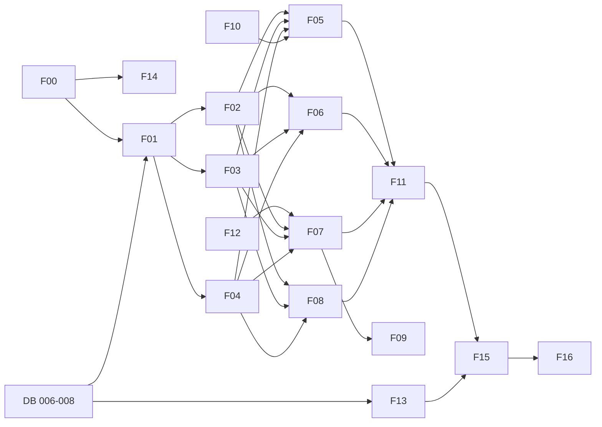

# FEATURE_UPGRADE_REQUIREMENTS.md

**Dự án:** `php_admin_product_manager` (PHP 8.2 + Apache, MySQL 8, Docker; không framework, không ORM)
**Mục tiêu:** nâng cấp thành phòng lab bảo mật có kiểm soát để trình diễn, khai thác, sửa và kiểm thử lại **Broken Access Control** (vertical/horizontal, BOLA/IDOR, BFLA) và **Mass Assignment / BOPLA** (OWASP API3:2023), theo khuôn khổ CEH v13.
**Trạng thái:** thiết kế đã được duyệt; chưa viết mã.
**Tài liệu liên quan:** `DATABASE_UPGRADE_AND_SEED.md` (schema, seed, truy vấn kiểm chứng).

---

## 1. Nguyên tắc chung

1. **Baseline không đổi:** panel admin (`index.php` switch routes) và `/api/*` cũ giữ nguyên hành vi. Danh tính cũ là bảng `admins` và session key `admin_id`.
2. **Lab v2 là lớp mới:** namespace `/api/v2/*`, danh tính mới là bảng `users` và session key `user_id`. Session `admin_id` **không** được chấp nhận ở v2 (và ngược lại).
3. **Secure trước, vulnerable sau:** triển khai bản an toàn làm đặc tả chuẩn; sau đó thêm nhánh lỗi có chủ đích sau cờ cấu hình (F11).
4. **Tái sử dụng tối đa:** `api_respond`, `api_success`, `api_error`, `ApiHttpException`, `api_request_data`, `api_id`, `api_integer`, `api_verify_csrf`, `db()`, `product_*`, `order_*`, `customer_*` hiện có. Phong cách: hàm thủ tục (procedural), PDO prepared statement; không đưa ORM vào.
5. **Default-deny:** route/hành động không có chính sách rõ ràng → 403.
6. **Mức độ ưu tiên:** 🔴 bắt buộc, 🟡 khuyến nghị, ⚪ tùy chọn.

---

## 2. Bản đồ tính năng

| ID | Tính năng | Ưu tiên | Phụ thuộc | Kịch bản |
|---|---|---|---|---|
| F00 | Cô lập lab và cờ chế độ | 🔴 | — | Mọi kịch bản |
| F01 | Danh tính và phiên lab (auth v2) | 🔴 | DB 006, F00 | B1 |
| F02 | RBAC: kiểm soát cấp hàm (Gate) | 🔴 | F01 | A1, A4 |
| F03 | Chính sách sở hữu đối tượng (Policy) | 🔴 | F01 | A2, A3 |
| F04 | Phân quyền cấp thuộc tính (FieldPolicy) | 🔴 | F01 | B1–B5 |
| F05 | API người dùng | 🔴 | F02–F04 | A1–A4, B1, B2, B5 |
| F06 | API địa chỉ | 🔴 | F03 | A2, A3 |
| F07 | API đơn hàng | 🔴 | F02–F04, F12 | A2, A3, B3 |
| F08 | API sản phẩm v2 | 🔴 | F02, F04 | A1, A4, B4 |
| F09 | Cập nhật trạng thái thanh toán | 🟡 | F07 | B3, A4 |
| F10 | Nhật ký kiểm toán bảo mật | 🟡 | DB 008 | Bằng chứng |
| F11 | Công tắc lỗ hổng (vulnerable toggles) | 🔴 | F02–F04 | Tất cả |
| F12 | Refactor `order_create()` | 🔴 | — | B3, hồi quy |
| F13 | Seeder và reset | 🔴 | DB 006–007 | Tất cả |
| F14 | Docker lab và dịch vụ test | 🔴 | F00 | Cô lập, kiểm thử |
| F15 | Bộ kiểm thử tự động | 🔴 | F05–F11, F13 | Tất cả |
| F16 | Bộ tài liệu | 🟡 | tất cả | Học thuật |
| F17 | Mở rộng tùy chọn (B5, `store_credit`, UI audit) | ⚪ | F05 | B5 |

---

## 3. Cấu hình chế độ lab (dùng xuyên suốt)

| Biến môi trường | Giá trị | Ý nghĩa |
|---|---|---|
| `LAB_MODE` | `secure` (mặc định) / `vulnerable` / `custom` | `secure`: không có lỗ hổng. `vulnerable`: bật tất cả lỗ hổng. `custom`: chỉ bật theo từng cờ bên dưới |
| `LAB_VULN_BAC_VERTICAL` | `0/1` | Bỏ qua Gate ở các hàm cấp cao (A1) |
| `LAB_VULN_BFLA` | `0/1` | Bỏ qua Gate ở hàm quản trị người dùng/sản phẩm (A4) |
| `LAB_VULN_BOLA` | `0/1` | Bỏ qua kiểm tra sở hữu (A2, A3) |
| `LAB_VULN_MASS_ASSIGN` | `0/1` | Cho phép gán mọi cột ở ghi (B1–B4) |
| `LAB_VULN_PROPERTY_EXPOSURE` | `0/1` | Trả thuộc tính nhạy cảm ở response (B5) |
| `LAB_DENY_STATUS_OBJECT` | `403` (mặc định) / `404` | Mã trả về khi vi phạm sở hữu ở secure mode |

Chỉ khi `LAB_MODE=custom` các cờ `LAB_VULN_*` mới có hiệu lực.

---

## 4. Đặc tả từng tính năng

### F00 — Cô lập lab và cờ chế độ 🔴
**Mục tiêu:** đảm bảo mã có lỗ hổng chủ đích không thể chạy ngoài môi trường local.
**File:** `app/src/lab/bootstrap.php` (mới); `docker-compose.lab.yml`, `.env.lab.example` (mới).
**Yêu cầu chức năng:**
- FR-00.1 Đọc `LAB_MODE`, `LAB_VULN_*`, `LAB_DENY_STATUS_OBJECT`; cung cấp hàm `lab_mode()` và `lab_vuln(string $flag): bool`.
- FR-00.2 Nếu bất kỳ lỗ hổng nào được bật mà `APP_ENV != local` → dừng với HTTP 500 và log, **không** xử lý request.
- FR-00.3 Nếu lỗ hổng bật và địa chỉ client (`REMOTE_ADDR`) không thuộc loopback hoặc dải mạng Docker nội bộ → từ chối (403).
- FR-00.4 Mọi response v2 có header `X-Lab-Mode: <mode>` để bằng chứng Burp ghi rõ chế độ.
- FR-00.5 Ghi `lab_mode` vào mỗi dòng audit.
**Phi chức năng:** không đọc cờ từ request (chỉ từ môi trường); giá trị không hợp lệ → rơi về `secure`.
**Tiêu chí chấp nhận:** đặt `APP_ENV=production` + `LAB_MODE=vulnerable` → ứng dụng v2 từ chối khởi động; secure mode không bị ảnh hưởng.

---

### F01 — Danh tính và phiên lab (auth v2) 🔴
**Mục tiêu:** có nhiều tác nhân (admin, staff, customer) dùng chung endpoint.
**File:** `app/src/lab/auth.php`, `app/src/lab/user_repository.php` (mới).
**Endpoint:**

| Method | Path | Mô tả |
|---|---|---|
| POST | `/api/v2/auth/register` | Tạo tài khoản customer |
| POST | `/api/v2/auth/login` | Đăng nhập bằng username hoặc email |
| POST | `/api/v2/auth/logout` | Đăng xuất |
| GET | `/api/v2/auth/csrf-token` | Lấy CSRF token |
| GET | `/api/v2/me` | Hồ sơ của chính mình |
| PATCH | `/api/v2/me` | Sửa hồ sơ của chính mình |

**Yêu cầu chức năng:**
- FR-01.1 Session dùng chung cookie hiện có (`SESSION_NAME`), lưu `$_SESSION["user_id"]` — **không** lưu role trong session. Mỗi request nạp lại user (role, `account_status`) từ DB để thay đổi quyền có hiệu lực ngay.
- FR-01.2 Đăng nhập: `password_verify`; gọi `session_regenerate_id(true)`; thông báo lỗi chung ("Thông tin đăng nhập không chính xác") không phân biệt sai tài khoản/mật khẩu. Không dùng fallback SHA-256 của hệ thống cũ.
- FR-01.3 Chỉ `account_status = 'active'` được đăng nhập và gọi API; `pending/suspended` → 403.
- FR-01.4 Đăng ký: tạo `users` với role `customer` và `account_status = 'active'` do **server** chọn, đồng thời tạo hồ sơ `customers` (`user_id` liên kết). Mật khẩu ≥ 12 ký tự (cùng chuẩn reset password hiện có); `username`, `email` UNIQUE → 409 nếu trùng.
- FR-01.5 CSRF: mọi POST/PUT/PATCH/DELETE (trừ `login`/`register`) yêu cầu header `X-CSRF-Token` khớp session, tái dùng `api_verify_csrf()`.
- FR-01.6 Content-Type bắt buộc `application/json` (tái dùng `api_request_data()`).

**Trường dữ liệu:**

| Endpoint | Chấp nhận | Phải từ chối (secure) |
|---|---|---|
| register | `username`, `email`, `password`, `full_name`, `phone` | `role_id`, `role`, `account_status`, `store_credit`, `id`, mọi trường khác |
| PATCH /me | `full_name`, `phone` | `role_id`, `account_status`, `store_credit`, `email`*, `password_hash`, `id` |

\* `email` chỉ nên cho sửa nếu triển khai xác minh; mặc định từ chối trong lab.

**Phản hồi mẫu (login):**
```json
{ "data": { "csrf_token": "..." } }
```
**Mã lỗi:** 400 JSON sai, 401 sai thông tin, 403 tài khoản không active, 409 trùng, 415 sai Content-Type, 419 CSRF, 422 trường không hợp lệ/bị cấm.
**Vulnerable (F11 / `MASS_ASSIGN`):** register và PATCH /me gán mọi cột tồn tại (B1, B2).
**Tiêu chí chấp nhận:** 6 tài khoản seed đăng nhập được; đăng ký thường tạo đúng role `customer`; `GET /me` không trả `password_hash`.

---

### F02 — RBAC: kiểm soát cấp hàm (Gate) 🔴
**Mục tiêu:** trả lời "vai trò này có được gọi hàm này không?".
**File:** `app/src/lab/authz.php`.
**Yêu cầu chức năng:**
- FR-02.1 `lab_user_permissions(int $roleId): array` nạp quyền từ `role_permissions` (cache trong request).
- FR-02.2 `lab_require_permission(array $user, string $code): void` ném `ApiHttpException(..., 403)` nếu thiếu quyền; ghi audit `deny` với `reason = missing_permission:<code>`.
- FR-02.3 Mỗi handler v2 **phải** gọi Gate hoặc Policy tường minh; có test bảo đảm không có route nào không gọi kiểm tra (default-deny).
- FR-02.4 Bảng quyền: xem ma trận ở mục 5.

**Vulnerable:** `LAB_VULN_BAC_VERTICAL` — các hàm sản phẩm/người dùng chỉ kiểm tra "đã đăng nhập", bỏ qua Gate (A1). `LAB_VULN_BFLA` — hàm quản trị `PUT /users/{id}/role`, `DELETE /users/{id}`, `DELETE /products/{id}` bỏ qua Gate (A4). Hai cờ tách riêng để phân biệt rõ kịch bản.
**Tiêu chí chấp nhận (secure):** customer gọi `DELETE /api/v2/products/3` → 403, dòng sản phẩm còn nguyên, có dòng audit `deny`.

---

### F03 — Chính sách sở hữu đối tượng (Policy) 🔴
**Mục tiêu:** trả lời "người gọi có được chạm vào bản ghi này không?".
**File:** `app/src/lab/authz.php`.
**Yêu cầu chức năng:**
- FR-03.1 `lab_owns_customer(array $user, int $customerId): bool` — `customers.user_id = user.id`.
- FR-03.2 `lab_can_access_order(array $user, array $order, string $op): bool` — chủ đơn (qua `orders.customer_id → customers.user_id`) hoặc người có `orders.read_all` (đọc) / `orders.update_status` (sửa trạng thái).
- FR-03.3 `lab_can_access_address(array $user, array $address, string $op): bool` — chỉ chủ địa chỉ.
- FR-03.4 `lab_can_access_user(array $user, int $targetId, string $op): bool` — chính mình hoặc `users.read_all`/`users.manage`.
- FR-03.5 Truy vấn phải nạp bản ghi **trước** rồi kiểm tra chủ sở hữu (không tin `customer_id`/`user_id` từ client); khi vi phạm: trả `LAB_DENY_STATUS_OBJECT` (403 hoặc 404) và ghi audit `reason = not_owner`.
- FR-03.6 ID không hợp lệ (không phải số nguyên dương) → 400 (tái dùng `api_id()`).
**Vulnerable:** `LAB_VULN_BOLA` — chỉ gọi `find($id)` rồi trả/sửa/xóa mà không so sánh chủ sở hữu (A2, A3). ID tuần tự bảo đảm có thể liệt kê.
**Tiêu chí chấp nhận (secure):** Alice `GET /api/v2/orders/3` → 403 (hoặc 404), body không chứa dữ liệu của Bob, DB không đổi.

---

### F04 — Phân quyền cấp thuộc tính (FieldPolicy) 🔴
**Mục tiêu:** kiểm soát **trường** nào được ghi (input allowlist) và trường nào được đọc (output projection).
**File:** `app/src/lab/input.php`.
**Yêu cầu chức năng:**
- FR-04.1 `lab_field_policy(resource, role, op): array` — danh sách trường cho phép, mặc định rỗng (deny).
- FR-04.2 `lab_filter_input(resource, user, op, input): array` — nếu có khóa ngoài allowlist → `ApiHttpException(422)` kèm `details.fields`, ghi audit `reason = restricted_field:<tên>`. (Chọn **từ chối** thay vì im lặng bỏ qua, để thấy rõ trong Burp; test vẫn khẳng định DB không đổi.)
- FR-04.3 `lab_project_output(resource, user, row): array` — loại `password_hash` ở mọi trường hợp; loại `role_id`, `account_status`, `store_credit` khi người xem không phải chủ sở hữu có quyền hoặc admin.
- FR-04.4 Danh sách chuẩn:

| Resource.op | Vai trò → trường được ghi |
|---|---|
| `users.update` | customer/staff (chính mình): `full_name`, `phone`; admin: thêm `account_status`; đổi role chỉ qua `PUT /users/{id}/role` |
| `orders.update` | customer: `shipping_address` (khi `status = new`); staff_orders/admin: `status` (qua state machine `order_update_status`) |
| `products.update` | staff_catalog: `name`, `description`, `category_id`, `brand_id`, `sku`; admin: thêm `unit_price`, `status` |
| `orders.create` | customer: `items[{product_id,quantity}]`, `address_id` |

- FR-04.5 Trường hệ thống không bao giờ ghi từ client: `id`, `created_at`, `updated_at`, `password_hash`, `role_id` (ngoài endpoint role), `customer_id`, `total_amount`, đơn giá/`line_total` của dòng hàng, `payment_status` (ngoài endpoint payment), `quantity` sản phẩm (chỉ qua `/api/inventory` hiện có).
- FR-04.6 Giữ nguyên quy tắc có sẵn: `api_resource_payload()` đã chặn sửa `quantity` trực tiếp (422); v2 phải giữ hành vi tương đương.
**Vulnerable:** `LAB_VULN_MASS_ASSIGN` — `lab_assign_all()`: lọc khóa theo **danh sách cột thật** của bảng (từ `information_schema`) thay vì allowlist; tên cột không lấy trực tiếp từ input để tránh SQL injection ngoài ý muốn. `LAB_VULN_PROPERTY_EXPOSURE` — response trả toàn bộ cột (bao gồm `password_hash`) cho B5.
**Tiêu chí chấp nhận:** `PATCH /me` với `{"role_id":1}` → 422 ở secure; ở vulnerable `users.role_id` trong DB đổi thành 1.

---

### F05 — API người dùng 🔴
**File:** `app/src/lab/api_v2.php`, `user_repository.php`.

| Method | Path | Quyền | Sở hữu | Trường ghi | Kịch bản |
|---|---|---|---|---|---|
| GET | `/api/v2/users` | `users.read_all` | — | — | A4 |
| GET | `/api/v2/users/{id}` | chính mình hoặc `users.read_all` | chính mình | — | A3, B5 |
| PATCH | `/api/v2/users/{id}` | chính mình / `users.manage` | chính mình | xem F04 | A2, B2 |
| PUT | `/api/v2/users/{id}/role` | `users.manage` | — | `role_id` | A1, A4 |
| DELETE | `/api/v2/users/{id}` | `users.delete` | — | — | A4 |

**Yêu cầu:** admin không được tự xóa/hạ quyền chính mình (422); đổi role phải tồn tại trong `roles` (422); ghi audit cho mọi thao tác `allow` và `deny`.
**Mã lỗi:** 400/401/403/404/419/422.
**Tiêu chí chấp nhận:** `lab_staff_ord` gọi `PUT /users/4/role` → 403 (secure); vulnerable → 200 và `users.role_id` của Alice đổi.

---

### F06 — API địa chỉ 🔴
| Method | Path | Quyền | Sở hữu |
|---|---|---|---|
| GET | `/api/v2/addresses` | đăng nhập (customer) | liệt kê của chính mình |
| POST | `/api/v2/addresses` | customer | gán vào hồ sơ customer của chính mình (server chọn `customer_id`) |
| GET | `/api/v2/addresses/{id}` | chủ sở hữu | `customers.user_id = actor` |
| PATCH | `/api/v2/addresses/{id}` | chủ sở hữu | như trên |
| DELETE | `/api/v2/addresses/{id}` | chủ sở hữu | như trên |

**Trường ghi:** `label`, `line1`, `city`, `phone`, `is_default`. **Cấm:** `id`, `customer_id`, `created_at`.
**Yêu cầu:** chỉ một địa chỉ mặc định mỗi customer; xóa địa chỉ không ảnh hưởng đơn đã tạo (đơn lưu snapshot `shipping_address`).
**Kịch bản:** A2 (Alice `DELETE /addresses/3` của Bob), A3 (IDOR theo ID).
**Tiêu chí chấp nhận:** secure → 403/404 và `SELECT id FROM addresses WHERE id IN (3,4)` vẫn trả 2 dòng; vulnerable → dòng bị xóa.

---

### F07 — API đơn hàng 🔴
| Method | Path | Quyền / sở hữu | Ghi chú |
|---|---|---|---|
| POST | `/api/v2/orders` | role `customer` | Checkout cho chính mình |
| GET | `/api/v2/orders` | customer: đơn của mình; `orders.read_all`: tất cả | |
| GET | `/api/v2/orders/{id}` | chủ đơn hoặc `orders.read_all` | A3 |
| PATCH | `/api/v2/orders/{id}` | customer: `shipping_address` khi `status=new`; `orders.update_status`: `status` | B3 |
| POST | `/api/v2/orders/{id}/cancel` | chủ đơn, tái dùng `order_can_cancel()` | A2 |

**Yêu cầu chức năng:**
- FR-07.1 Checkout: nhận `items` và `address_id` (địa chỉ phải thuộc chính customer; ngược lại 403/404). Server tự lấy tên/điện thoại/địa chỉ từ DB, đơn giá và `line_total` từ `products`, `total_amount` do server tính, `status = 'new'`, `payment_status = 'unpaid'`, `customer_id` từ hồ sơ của người gọi. Tái dùng `order_create()` (đã tính giá phía server, có khóa dòng `FOR UPDATE` và trừ kho).
- FR-07.2 Giữ nguyên luồng trạng thái hiện có: `new → confirmed → processing → shipping → completed`; hủy khi `new/confirmed/processing` (hoàn kho trong cùng transaction, đã có trong `order_update_status`).
- FR-07.3 Chuẩn bị response: dòng hàng kèm `id` của `order_items` (cần thêm vào truy vấn `order_find`, F12).
- FR-07.4 Customer **không** được gửi: `total_amount`, `status`, `payment_status`, `customer_id`, `unit_price`, `line_total` (422).
**Vulnerable:** `LAB_VULN_BOLA` ở GET/PATCH/cancel; `LAB_VULN_MASS_ASSIGN` ở POST (B3): server nhận và ghi `total_amount`, `status`, `payment_status`, `customer_id`, `unit_price` từ body.
**Request khai thác mẫu (B3, chỉ trên lab local):**
```http
POST /api/v2/orders HTTP/1.1
Host: localhost:8090
Content-Type: application/json
X-CSRF-Token: <token của bob>
Cookie: ADMIN_PRODUCT_SESSION=<phiên của bob>

{"items":[{"product_id":2,"quantity":1}],"address_id":3,
 "total_amount":1,"payment_status":"paid","status":"completed"}
```
- Vulnerable: `orders.total_amount = 1`, `payment_status = 'paid'`.
- Secure: 422 `details.fields = ["total_amount","payment_status","status"]`; không có dòng đơn mới.
**Tiêu chí chấp nhận:** Alice không đọc/sửa/hủy được đơn 3–4; đơn hàng tạo bằng checkout hợp lệ có giá bằng `products.unit_price` tại thời điểm tạo.

---

### F08 — API sản phẩm v2 🔴
| Method | Path | Quyền | Ghi chú |
|---|---|---|---|
| GET | `/api/v2/products`, `/{id}` | đăng nhập | Phân trang giống `/api/products` |
| POST | `/api/v2/products` | `products.update` | Tạo mới; `unit_price` bắt buộc `products.set_price` |
| PATCH | `/api/v2/products/{id}` | `products.update`; đổi `unit_price`/`status` cần `products.set_price` | B4 |
| DELETE | `/api/v2/products/{id}` | `products.delete` | A1, A4 |

**Yêu cầu:** tái dùng `product_find`, `product_update`, `product_delete`, `product_paginate`; dọn ảnh giống `api_item()` khi xóa; `quantity` vẫn chỉ đổi qua `/api/inventory` (422 nếu gửi giá trị khác).
**Kịch bản:** A1 (customer xóa), A4b (`lab_staff_cat` xóa), B4 (`lab_staff_cat` gửi `{"unit_price":1}`).
**Tiêu chí chấp nhận:** `lab_staff_cat` cập nhật `description` thành công (200) nhưng `unit_price` → 422/403 ở secure; admin đổi giá thành công.

---

### F09 — Trạng thái thanh toán 🟡
| Method | Path | Quyền | Trường |
|---|---|---|---|
| PUT | `/api/v2/orders/{id}/payment` | `orders.set_payment` (admin) | `payment_status ∈ {unpaid, paid, refunded}` |

**Yêu cầu:** giá trị ngoài enum → 422; chỉ admin; ghi audit. Đây là điểm duy nhất ghi `payment_status`.
**Kịch bản:** B3, A4 (staff_orders thử gọi → 403).

---

### F10 — Nhật ký kiểm toán bảo mật 🟡
**File:** `app/src/lab/audit.php`; endpoint `GET /api/v2/audit` (`audit.read`).
**Yêu cầu:**
- FR-10.1 `lab_audit(decision, reason, targetType, targetId)` ghi `actor_user_id`, `method`, `route`, `lab_mode`, `ip_address`.
- FR-10.2 Ghi cả `allow` và `deny`; không ghi mật khẩu, token hay body đầy đủ.
- FR-10.3 Lỗi ghi audit không được làm hỏng request chính (bắt ngoại lệ và `error_log`).
**Lý do:** cung cấp bằng chứng độc lập với mã HTTP: cho thấy yêu cầu vượt quyền thành công ở vulnerable và bị chặn ở secure.

---

### F11 — Công tắc lỗ hổng 🔴
**Nguyên tắc:** toàn bộ nhánh lỗ hổng nằm trong `lab/authz.php` và `lab/input.php`, không rải rác trong handler. Handler luôn gọi cùng một hàm kiểm tra; hàm đó quyết định bỏ qua hay thực thi dựa trên `lab_vuln()`.

| Cờ | Hàm bị ảnh hưởng | Hành vi vulnerable | Kịch bản |
|---|---|---|---|
| `BAC_VERTICAL` | `lab_require_permission` ở products/users | Chỉ yêu cầu đăng nhập | A1 |
| `BFLA` | `lab_require_permission` ở role/xóa user/xóa sản phẩm | Bỏ qua | A4 |
| `BOLA` | `lab_can_access_*` | Trả `true` | A2, A3 |
| `MASS_ASSIGN` | `lab_filter_input` → `lab_assign_all` | Chấp nhận mọi cột thật | B1–B4 |
| `PROPERTY_EXPOSURE` | `lab_project_output` | Trả toàn bộ cột | B5 |

**Yêu cầu:** mỗi cờ độc lập; tắt tất cả ≡ secure; mọi dòng audit ghi `lab_mode`.
**Tiêu chí chấp nhận:** bật/tắt từng cờ trong `custom` chỉ làm thay đổi kịch bản tương ứng (kiểm bằng test).

---

### F12 — Refactor `order_create()` 🔴
**File:** `app/src/order_repository.php` (thay đổi duy nhất đối với logic nghiệp vụ hiện có).
**Lý do:** `order_create(array $customer, array $items, int $adminId)` gọi `order_require_positive_int($adminId, ...)` và ghi `inventory_movements.admin_id` (cột cho phép NULL, FK tới `admins`). Customer checkout không có `admin_id`.
**Yêu cầu:**
- FR-12.1 Đổi tham số thành `?int $adminId = null`; nếu `null` thì không validate là số dương và ghi NULL vào `admin_id`; panel/API cũ tiếp tục truyền `(int) $_SESSION["admin_id"]`.
- FR-12.2 `order_find()` trả thêm `order_items.id` và `payment_status` (cột mới có mặc định, không phá panel).
- FR-12.3 Không thay đổi: tính giá phía server, khóa `FOR UPDATE`, trừ kho có điều kiện `quantity >= :minimum_quantity`, hoàn kho khi hủy.
**Hồi quy bắt buộc:** tạo đơn từ panel, tạo đơn qua `/api/orders`, hủy đơn hoàn kho, và `quantity` trực tiếp vẫn trả 422.

---

### F13 — Seeder và reset 🔴
**File:** `database/lab/seed_lab.php`.
Xem đặc tả đầy đủ trong `DATABASE_UPGRADE_AND_SEED.md` (mục 6). Yêu cầu chính: idempotent, `--reset`, từ chối khi `APP_ENV != local`, băm mật khẩu lúc chạy, không chứa mật khẩu/hash trong SQL.

---

### F14 — Docker lab và dịch vụ test 🔴
**File:** `docker-compose.lab.yml`, `.env.lab.example`.
**Yêu cầu:**
- FR-14.1 Ghi đè cổng để chỉ lắng nghe loopback: `127.0.0.1:8090:80`, `127.0.0.1:3308:3306`, `127.0.0.1:8091:80` (compose gốc đang publish trên mọi interface).
- FR-14.2 Chạy bằng project riêng (`-p phplab`) với volume `mysql_lab_data` riêng để tách dữ liệu khỏi môi trường gốc.
- FR-14.3 Dịch vụ `lab-tests` (image `php:8.2-cli` + Composer) trong cùng mạng, gọi `http://php-app`; không sửa `docker/php/Dockerfile`.
- FR-14.4 `.env.lab.example` có `APP_ENV=local`, `LAB_MODE=secure`; mật khẩu DB chỉ là giá trị lab.
**Lưu ý:** `.env` hiện được commit chứa mật khẩu DB mặc định; chỉ chấp nhận được vì là mật khẩu lab local, không dùng lại ở nơi khác.

---

### F15 — Bộ kiểm thử tự động 🔴
**Cách làm:** PHPUnit + Guzzle (black-box HTTP), mỗi tác nhân có cookie jar và CSRF token riêng; kiểm tra DB bằng PDO. Cùng một bộ test chạy ở hai chế độ: `secure` (kỳ vọng chặn) và `vulnerable` (kỳ vọng khai thác được).

| Nhóm | Kiểm tra | Secure | Vulnerable |
|---|---|---|---|
| Vertical | Alice xóa sản phẩm 3 | 403, row còn | 200, row mất |
| BFLA | `lab_staff_ord` đổi role user 4 | 403 | 200, role đổi |
| Horizontal/BOLA | Alice đọc đơn 3; xóa địa chỉ 3 | 403/404 | 200 dữ liệu Bob; row mất |
| B1 | Đăng ký kèm `role_id=1` | 422 | user có role admin |
| B2 | `PATCH /me` kèm `store_credit` | 422 | DB đổi |
| B3 | Checkout kèm `total_amount=1`, `payment_status=paid` | 422 | DB ghi giá trị giả |
| B4 | `lab_staff_cat` đổi `unit_price` | 403/422 | DB đổi |
| B5 | `GET /me` | không có `password_hash` | có `password_hash` |
| Hợp lệ | Admin CRUD; customer checkout/hủy; đổi `full_name` | 2xx | 2xx |
| Hồi quy cũ | Đăng nhập admin, CRUD sản phẩm, tạo/hủy đơn hoàn kho, `quantity` trực tiếp = 422 | pass | pass |

**Tiêu chí chấp nhận:** mỗi test ID có đủ: tiền điều kiện, request gốc, request chỉnh sửa, kết quả mong đợi theo từng chế độ, bằng chứng DB.

---

### F16 — Bộ tài liệu 🟡
`PROJECT_ANALYSIS.md`, `SECURITY_REQUIREMENTS.md`, `DATABASE_DESIGN.md`, `API_SPECIFICATION.md`, `ATTACK_SCENARIOS.md`, `REMEDIATION_GUIDE.md`, `TEST_PLAN.md`, `IMPLEMENTATION_ROADMAP.md` (nội dung đã mô tả trong blueprint). File này và `DATABASE_UPGRADE_AND_SEED.md` là nguồn cho `API_SPECIFICATION.md`/`DATABASE_DESIGN.md`/`TEST_PLAN.md`.

---

### F17 — Mở rộng tùy chọn ⚪
- B5 (rò rỉ thuộc tính ở response) và `store_credit` đã có trong schema; nếu bỏ qua, có thể xóa cột `store_credit` khỏi migration.
- Trang quản trị UI cho audit log; bảng `payments`; quyền theo từng user (override) — không thuộc phạm vi hiện tại.

---

## 5. Ma trận quyền (nguồn chuẩn cho F02–F04)

| Thao tác | Customer | staff_catalog | staff_orders | Admin |
|---|---|---|---|---|
| Đăng ký / đăng nhập | ✓ | ✓ | ✓ | ✓ |
| Xem/sửa hồ sơ của mình (`full_name`, `phone`) | ✓ | ✓ | ✓ | ✓ |
| Đổi `role_id`/`account_status` của chính mình | ✗ | ✗ | ✗ | ✗ |
| Xem user khác (`users.read_all`) | ✗ | ✗ | ✗ | ✓ |
| Đổi role/status user (`users.manage`) | ✗ | ✗ | ✗ | ✓ |
| Xóa user (`users.delete`) | ✗ | ✗ | ✗ | ✓ |
| Xem sản phẩm | ✓ | ✓ | ✓ | ✓ |
| Tạo/sửa sản phẩm, không giá (`products.update`) | ✗ | ✓ | ✗ | ✓ |
| Đổi giá (`products.set_price`) | ✗ | ✗ | ✗ | ✓ |
| Xóa sản phẩm (`products.delete`) | ✗ | ✗ | ✗ | ✓ |
| Đặt đơn | ✓ (của mình) | ✗ | ✗ | ✗ |
| Xem đơn | của mình | ✗ | tất cả | tất cả |
| Cập nhật trạng thái đơn | hủy đơn của mình (nếu hủy được) | ✗ | ✓ | ✓ |
| Đặt `payment_status` (`orders.set_payment`) | ✗ | ✗ | ✗ | ✓ |
| CRUD địa chỉ | của mình | của mình | của mình | của mình |
| Xem audit log (`audit.read`) | ✗ | ✗ | ✗ | ✓ |

---

## 6. Yêu cầu phi chức năng

- **Truy vấn:** 100% prepared statements; tên cột động (chỉ ở `lab_assign_all`) phải lấy từ danh sách `information_schema`, không từ input.
- **Phản hồi:** dùng chung envelope `{"data":...}` / `{"error":{"message","details"}}`; không lộ stack trace hay thông điệp PDO.
- **Hiệu năng:** không yêu cầu đặc biệt (lab); tránh N+1 rõ ràng ở danh sách đơn.
- **Tính tương thích:** không đổi hành vi `/api/*` và panel cũ; mọi thay đổi ở `index.php` giới hạn trong một nhánh định tuyến `/api/v2/*` đặt trước nhánh `/api`.
- **Bảo mật vận hành:** cờ lỗ hổng chỉ từ biến môi trường; lỗ hổng chỉ chạy trong môi trường local (F00).

---

## 7. Thứ tự triển khai và phụ thuộc



| Giai đoạn | Nội dung | Tiêu chí hoàn thành |
|---|---|---|
| 0 | F00, F14, tag baseline | Cổng chỉ loopback; panel cũ và `/api` vẫn chạy |
| 1 | DB 006–008, F13 | Dữ liệu seed đúng mục 6 của tài liệu DB; chạy lại không trùng |
| 2 | F01 | 6 tài khoản đăng nhập; `GET /me` an toàn |
| 3 | F02–F04, F05–F08, F09, F10 (bản secure) | Mọi kết quả "secure" của F15 pass; mọi route default-deny |
| 4 | F12 | Hồi quy cũ pass |
| 5 | F11 | Mỗi cờ tái hiện đúng kịch bản; tắt hết = secure |
| 6 | F15 | Cùng bộ test pass ở cả hai chế độ |
| 7 | F16 | Mỗi test ID có bằng chứng request/response/DB |

---

## 8. Phân biệt các loại lỗ hổng (tham chiếu nhanh)

| Loại | Câu hỏi | Khi nào xuất hiện | Ví dụ trong lab |
|---|---|---|---|
| Vertical escalation | Vai trò thấp có gọi được chức năng của vai trò cao? | Thiếu Gate | Customer xóa sản phẩm |
| BFLA | Vai trò này gọi được **hàm** này không? | Gate thiếu ở hàm quản trị | Staff đổi role user |
| Horizontal escalation / BOLA / IDOR | Người này chạm được **bản ghi** của người cùng vai trò khác? | Thiếu kiểm tra sở hữu, ID đoán được | Alice đọc đơn 3 của Bob |
| Mass Assignment / BOPLA | Người này ghi/đọc được **trường** này không? | Không có allowlist/projection | Gửi `role_id`, `payment_status` |

---

## 9. Điểm chưa xác định / cần theo dõi

- Chưa đọc hết `index.php` (dòng 260–504, 605–793) và các repository kho/thương hiệu/danh mục; sẽ rà soát trước khi sửa `index.php` và `order_repository.php`.
- Cờ cookie phiên (`HttpOnly`, `SameSite`, `Secure`) chưa được code thiết lập; cần kiểm tra thực tế bằng Burp. Nếu cần, đặt `session_set_cookie_params` trong bootstrap lab, không sửa `auth.php`.
- Chọn tên đường dẫn `/api/v2/...` thay cho `/api/...` để không đụng route admin cũ; nếu bạn muốn URL ngắn như `/api/orders/{id}` cho khách, cần thiết kế lại phân tách theo danh tính.
- Mức độ chi tiết của test ID (HTTP request đầy đủ cho từng ca) sẽ hoàn thiện trong `TEST_PLAN.md` ở giai đoạn 7.
